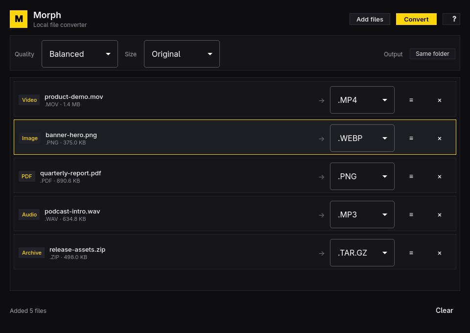

# Morph



Local all-in-one file converter for Omarchy. Drop files or pick them from the portal chooser, choose target formats and quality presets, and convert videos, audio, images, documents, PDFs, and archives locally without uploading anything.

## Supported conversions

- **Video**: `mp4`, `mkv`, `webm`, `mov`, `avi`, `flv`, `wmv`, `m4v`, `ts`, `mpg`, `3gp`, `ogv` → `mp4`, `mkv`, `webm`, `mov`, `gif`, or extract audio (`mp3`, `m4a`, `flac`, `wav`, `opus`) via `ffmpeg`
- **Audio**: `mp3`, `wav`, `flac`, `m4a`, `aac`, `ogg`, `opus`, `wma`, `aiff`, `alac`, `amr`, `mka` → `mp3`, `m4a`, `flac`, `wav`, `opus`, `ogg`, `aac` via `ffmpeg`
- **Images**: `png`, `jpg`, `webp`, `avif`, `gif`, `tiff`, `bmp`, `ico`, `heic`, `svg`, `tga`, `ppm`, `psd` → `png`, `jpg`, `webp`, `avif`, `gif`, `tiff`, `bmp`, `ico`, `pdf` via ImageMagick
- **Documents & Office**: `docx`, `doc`, `odt`, `rtf`, `txt`, `html`, `md`, `xlsx`, `ods`, `csv`, `pptx`, `odp` → `pdf` and cross-format office exports via LibreOffice
- **PDF**: `pdf` → `png`, `jpg`, `webp` pages (`pdftoppm`), `txt` (`pdftotext`), or compressed `pdf` (`gs`)
- **Archives**: `zip`, `7z`, `tar`, `tar.gz`, `tar.xz`, `tar.bz2`, `rar`, `iso` → `zip`, `7z`, `tar`, `tar.gz`, `tar.xz`, `tar.bz2` via `7z` and `tar`

## Shortcuts

| Key | Action |
| --- | --- |
| `O` / `Ctrl+O` | Add files |
| `D` | Choose output folder |
| `Space` / `Return` | Convert queued files (or cancel active conversion) |
| `↑` / `↓` | Select file in queue |
| `←` / `→` | Cycle target format for selected file |
| `Del` / `Backspace` | Remove selected file |
| `Ctrl+Z` / `Ctrl+Shift+Z` | Undo / Redo queue changes |
| `C` | Clear queue |
| `?` | Show or hide shortcuts |
| `Q` / `Ctrl+Q` | Quit |

## CLI

```sh
morph check --json
morph formats clip.mov --json
morph convert clip.mov --to mp4 --quality balanced --json
morph skill install
```

## Build and install

```sh
./bin/build
./bin/test
./bin/install
```
